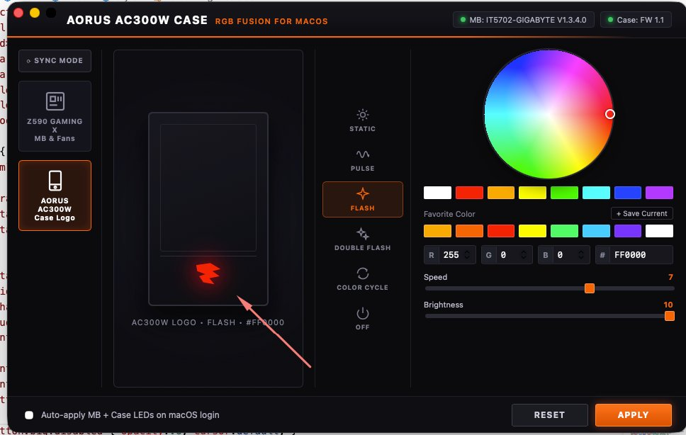
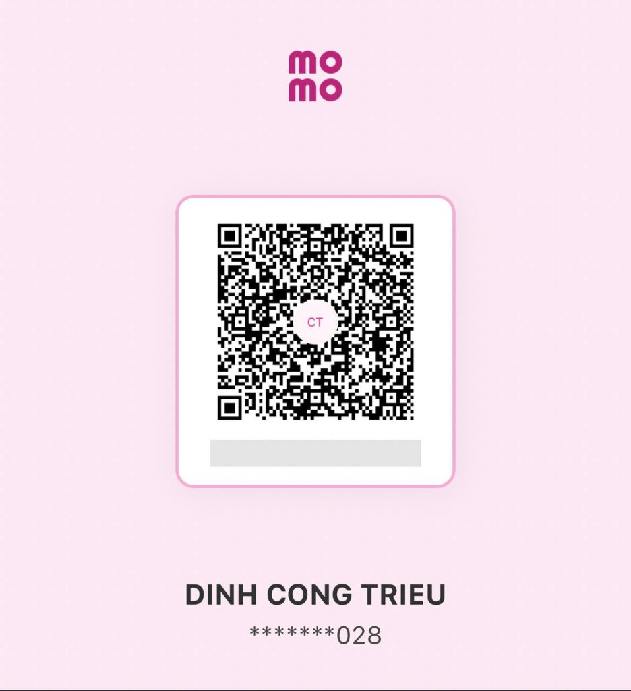

# AORUS RGB Fusion for macOS

[](https://www.apple.com/macos/)
[](LICENSE)
[-brightgreen)](#build-from-source)

A lightweight (~40 KB), native **macOS GUI & CLI** controller for **GIGABYTE / AORUS RGB Fusion 2.0** hardware — built directly on macOS `IOKit` HID with **zero third-party dependencies** and **no `sudo` required**.

Designed especially for **Hackintosh** and macOS users whose AORUS case logo turns off after BIOS or whose GIGABYTE motherboard / ARGB fan headers cannot be controlled by OpenRGB.



---

## Features

- **Native RGB Fusion 2.0 Dark UI**: Interactive HSV color wheel, RGB/Hex inputs, preset swatches, favorite colors, Speed & Brightness sliders.
- **Live Hardware Preview**: Clicking or dragging colors/modes updates the physical LEDs immediately without wearing out chip EEPROM; click **APPLY** to commit to flash/EEPROM and save your profile.
- **Multi-Device + Sync Mode**: Control your **GIGABYTE Motherboard (all 7 LED/ARGB fan headers)** and **AORUS Case Logo** independently or sync them together with one click.
- **Auto-Apply on macOS Login**: Built-in `LaunchAgent` toggle automatically restores your saved motherboard, fan, and case lighting every time macOS boots.
- **CLI Tool Included**: Scriptable `aorus-led` command-line binary for automation and Shortcuts.
- **Ultra-Lightweight**: Pure C / Objective-C + Cocoa/WebKit (~40 KB binary, launches in < 0.2s, no Electron bloat).

---

## Supported Hardware

### 1. GIGABYTE / AORUS USB-HID Cases & Peripherals (`VID: 0x1044`, HOLTEK)
| PID | Model |
| :--- | :--- |
| `0x7A30` | AORUS AC300W / C300 Glass *(verified)* |
| `0x7A3C` | AORUS AC300W Lite / XC700W |
| `0x7A27` | GIGABYTE XC300W / XTC700 |
| `0x7A29` | AORUS ATC700 |
| `0x7A32` | AORUS P7 |
| `0x7A34` | AORUS H5 |
| `0x7A3D` / `0x7A3E` | AORUS RGB Case / Peripheral |

### 2. GIGABYTE Motherboards & ARGB Fan Headers (`VID: 0x048D`, ITE)
| PID | Controller | Supported Zones |
| :--- | :--- | :--- |
| `0x5702` | ITE IT5702 *(Z590 / Z690 / B550 / X570S, verified)* | `LED_C1`, `LED_C2`, `D_LED1 (Fans)`, `D_LED2 (Fans)`, `Onboard LED 1-3` |
| `0x8297` | ITE IT8297 *(Z390 / Z490 / X570 / B450)* | All 7 hardware LED / ARGB zones |

> **Note:** Make sure **OpenRGB** is closed before launching AORUS RGB Fusion, as OpenRGB holds an exclusive HID lock on the `0x048D` motherboard controller.

---

## Installation & Build from Source

Requires macOS 11+ and Xcode Command Line Tools (`xcode-select --install`).

```bash
git clone https://github.com/congtrieu112/aorus-rgb-fusion-mac.git
cd aorus-rgb-fusion-mac
make install
```

This compiles both `AORUS RGB Fusion.app` and `aorus-led`, and installs `AORUS RGB Fusion.app` into `/Applications`.

To build a distributable `.zip` without installing:
```bash
make zip
# Output: dist/AORUS-RGB-Fusion-macOS.zip
```

---

## CLI Usage (`aorus-led`)

```bash
# Detect connected devices and firmware versions
./build/aorus-led --info

# Set both Motherboard + Case to warm AORUS gold
./build/aorus-led --target all --color FFAA00 --mode static --brightness 10

# Set only AORUS Case logo to red pulse
./build/aorus-led --target case --color FF0000 --mode pulse --speed 6 --brightness 10

# Set only ARGB Fan header D_LED1 (zone 5) to rainbow wave
./build/aorus-led --target mb --zone 5 --mode wave --speed 5 --brightness 10

# Turn off all LEDs
./build/aorus-led --target all --off

# Re-apply config saved by the GUI (~/.config/aorus-led/config.json)
./build/aorus-led --apply-saved
```

Available modes (`--mode`): `off`, `static`, `pulse`, `flash`, `doubleflash`, `cycle`, `wave` *(motherboard)*.

---

## Reverse-Engineered USB HID Protocol Notes

- **HOLTEK AORUS Case (`0x1044:0x7A30`, `UsagePage 0xFF01`, 8-byte Feature Report, Report ID `0x00`)**:
  - Firmware query: `01 00 00 00 00 00 00 00` → `GetReport` returns `[80, major, minor, ...]`
  - Set color: `01 C8 R G B 08 01 00`
  - Set mode/brightness/speed: `01 C9 mode bri (11-speed) 01 08 00`
  - Save to EEPROM: `01 B6 00 00 00 00 00 00`
- **ITE Motherboard (`0x048D:0x5702` / `0x8297`, `UsagePage 0xFF89`, 64-byte Feature Report, Report ID `0xCC`)**:
  - Device info: `CC 60 ...` → `GetReport` returns product string & firmware version
  - Disable software strip override: `CC 32 00 ...`
  - Configure zone `i` (`0..6`): `CC (0x20 + i) [DataFormat_8297]`
  - Apply mask: `CC 28 <bitmask> ...`
  - Save to flash: `CC 5E ...`

---

## Support This Project / Buy Me a Coffee

If you find this tool genuinely useful after searching for a macOS RGB Fusion solution, consider starring the repo or buying me a coffee!

*Nếu bạn thấy công cụ này thật sự hữu ích, hãy cho repo 1 sao hoặc mời mình một ly cafe qua MoMo bên dưới nhé!*

<p align="center">
  
</p>

---

## License

MIT License — see [LICENSE](LICENSE).
